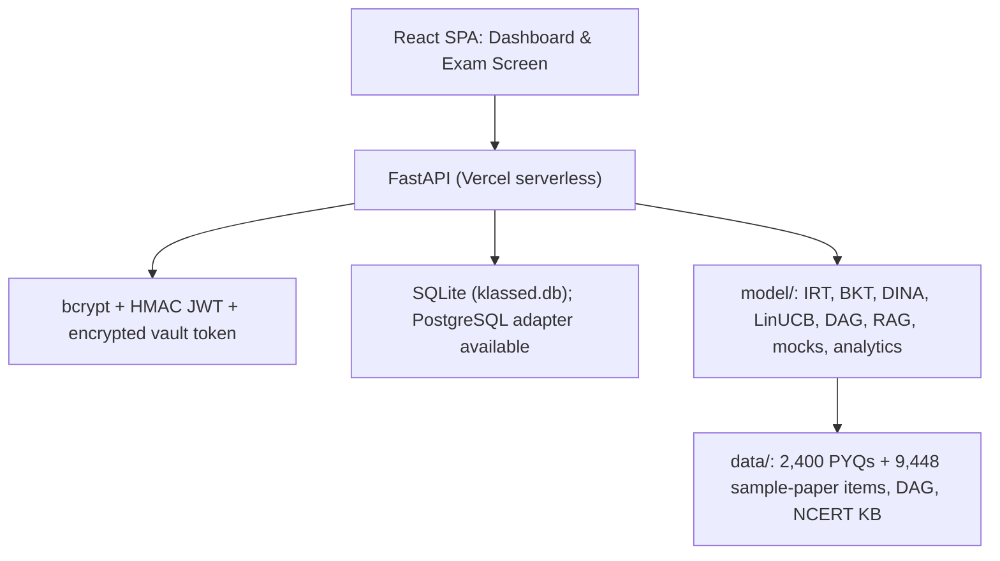

# Klassed NEET Adaptive Engine

**Author:** Udbhav Yadav (ML Engineer Intern) · **Institution:** Bennett University  
**Repository:** `udbhav968-creator/INETERNSHIP_WORK` · **Upstream:** `parvwadhwa/Klassed-neet-adaptive-engine`  
**Live app:** [klassed-neet-adaptive-engine.vercel.app](https://klassed-neet-adaptive-engine.vercel.app)  
**Stack:** Python 3.11+, FastAPI, NumPy, SciPy, scikit-learn, SQLite (PostgreSQL adapter available), React 18, TypeScript, Vite, Tailwind CSS, Vercel serverless.

**Key documents**

| Document | Purpose |
|---|---|
| [`docs/ML_INITIAL_ASSESSMENT_BLUEPRINT.md`](docs/ML_INITIAL_ASSESSMENT_BLUEPRINT.md) | ML handoff: 180-Q initial assessment, mocks, profile initialization, analytics, training status |
| [`docs/DATASET_BRIEF_SAMPLE_PAPERS_001_101.md`](docs/DATASET_BRIEF_SAMPLE_PAPERS_001_101.md) | Review of the 16,689-row sample-paper dataset |
| [`docs/spec.md`](docs/spec.md) | Original v1 technical spec (Pranay) |
| [`docs/POSTGRES_MIGRATION_PLAN.md`](docs/POSTGRES_MIGRATION_PLAN.md) | Persistence plan (needed before production use, see §9) |
| `docs/klassed_project_architecture_and_deep_explanation.{html,docx}` | Historical snapshot (12 Nov 2026); superseded where it conflicts with this README |

---

## 1. What the engine does

Klassed is an adaptive NEET-UG practice platform. It estimates each student's ability and per-chapter mastery from their answers and response times. It uses those estimates to choose questions, predict a NEET score range and build a study plan.

Two signals are tracked separately, following the spec:
- **Accuracy stream:** 3PL IRT ability (θ) and BKT chapter mastery.
- **Pacing stream:** a log-normal response-time model with fast/slow pace flags, implemented in `model/dina_cognitive_diagnosis.py`.

> **Honesty note on "trained" vs "prior".** No real student responses exist yet (`data/training/student_attempts.csv` has 0 rows). Every model that should learn from students (IRT item parameters, BKT, DINA, the bandit and probability calibration) currently runs on **priors derived from question metadata**, not on fitted student data. §6 says exactly which is which.

---

## 2. Architecture



The adaptive loop: select questions (LinUCB + IRT information) → student answers → update IRT θ, BKT mastery, pace, DINA skills and bandit → DAG propagation → score prediction and study plan.

---

## 3. Question bank

| Source | Items | Difficulty labels | IRT parameters |
|---|---|---|---|
| NEET PYQs 2013–2026 (`neet_questions_clean.json`) | 2,400 | **Heuristic**: `chapter_text_complexity_quantile_heuristic` | Tier defaults + metadata heuristics (no student data) |
| Sample Papers 1–101 (`neet_samples_001_to_101_verified.json`) | 9,448 accepted of 16,689 | Verified by the content team | Cold-start ridge, linked to the PYQ scale per subject × tier |

| Subject (PYQ) | Subject–chapter units | Basic | Medium | Advanced | Total |
|---|---|---|---|---|---|
| Physics | 22 | 122 | 274 | 147 | 543 |
| Chemistry | 24 | 154 | 302 | 177 | 633 |
| Biology | 20 | 321 | 588 | 315 | 1,224 |
| **Total** | **66** (65 distinct names) | 597 | 1,164 | 639 | 2,400 |

Known gaps:
- "Thermodynamics" exists in both Physics and Chemistry. The database keys topics by chapter name, so the two merge into one topic (backend fix pending).
- The PYQ bank has **5 empty chapter × tier cells**:
  - Chemistry · Environmental Chemistry · medium
  - Chemistry · s-Block Elements · basic
  - Physics · Dual Nature of Matter · basic
  - Physics · Electromagnetic Induction · advanced
  - Physics · Wave Optics · basic
- 15 more cells have fewer than 3 items. The adaptive generator falls back to adjacent tiers for these.
- `ideal_time_sec` is generated from the tier (`synthetic_tier_formula`). It is **not** a measured solving time, and it is excluded from every predictive model.
- 815 unverified items stay quarantined in `data/quarantine/neet_unverified_augmented.json`.

---

## 4. Models

| # | Model | Where | What it actually is today |
|---|---|---|---|
| 1 | 3PL IRT + MAP θ update | `model/irt_3pl_model.py`, `irt_item_parameters.json` | Ability estimation is real. Item a/b/c are **priors** from tier and metadata |
| 2 | 3D MIRT profile | `model/irt_3pl_model.py` | Conceptual / formula / numerical ability split; heuristic skill tagging |
| 3 | Cold-start IRT ridge | `irt_cold_start_ridge.npz` | Predicts a/b/c for new items. Its inputs include the item's tier label, so its high R² mostly reflects the tier |
| 4 | BKT + Ebbinghaus decay | `model/state_machine/bkt_model.py`, `bkt_chapter_parameters.json` | Update rule is real; per-chapter L0/T/G/S are **priors** |
| 5 | DINA 8-skill + log-normal pace | `model/dina_cognitive_diagnosis.py` | Regex Q-matrix; slip/guess are **priors** |
| 6 | Prerequisite DAG | `model/knowledge_graph_dag.py` | 65 nodes, acyclic; shrinkage and propagation |
| 7 | LinUCB bandit | `model/linucb_bandit.py`, `linucb_prior_init.json` | Warm start fitted to a synthetic reward; its R² and regret are simulation sanity checks, **not** learning evidence |
| 8 | Graph-Laplacian leverage | `conformal_laplacian_model.json` | Ranks chapters by downstream marks |
| 9 | NEET score simulator | `model/monte_carlo_conformal_neet.py` | 500-trial **Monte Carlo** interval. Not a calibrated conformal interval until real scores exist; the API key `conformal_90_interval` is kept for compatibility |
| 10 | Negative-marking rule | same | Skip when P(correct) < 0.20 |
| 11 | NCERT RAG + trap detector | `model/rag_socratic_engine.py` | TF-IDF + 32-D SVD over 65 NCERT chapter notes |
| 12 | Difficulty classifier (RF) | `question_difficulty_model.joblib`, `rf_difficulty_forest.npz` | Retrained **without** the tier-leaking features (see §5) |
| 13 | Temperature scaling | `rf_temperature_calibration.json` | Re-fitted on the leak-free classifier: T* = 0.96, 10-bin ECE 0.038 → 0.037 (the model was already near-calibrated) |
| 14 | Near-duplicate guard | `question_similarity_report.json`, `unified_near_duplicate_map.json` | PYQ map + 11,848-item map used by mocks |
| 15 | Study plan & coverage | `model/study_plan_and_coverage_engine.py` | Coverage, weak chapters, spaced re-test queue |

**Added for the 180-Q roadmap:** `assessment_blueprint.py` (3 IRT-equated initial-assessment forms), `mock_test_generator.py` (unlimited equated mocks), `student_profile_initializer.py`, `test_analytics_engine.py`, `chapter_resolver.py`, `sample_paper_ingestion.py`, `difficulty_model_v2.py` (leak audit + v2 candidate), `unified_similarity_guard.py`, `unified_corpus_report.py`, `ml_extension_registry.py`.

---

## 5. Difficulty-classifier correction

| Setup | Accuracy | Majority-class baseline |
|---|---|---|
| Previous production features (incl. `ideal_time_sec`) | 97.5% (5-fold) — inflated; previously reported as 99.79% | 48.5% |
| **Current production (leaked features removed)** | **80.8%** holdout · **80.1%** 5-fold CV (macro F1 0.80) | 48.5% |
| v2 candidate on verified sample tiers, held-out papers | 78.5% | 52.5% |
| PYQ-trained model scored against verified sample tiers | 42.2% | 52.5% |

The PYQ tier labels agree with the verified labels only 43% of the time, so tier quality, not model capacity, is the main limit. Details: `model/difficulty_model_leakage_audit.json`.

---

## 6. Training status

| Needs | Status |
|---|---|
| Question-content models (difficulty RF, chapter resolver, near-duplicate guard, RAG) | ✅ Trained on available data |
| New dataset calibration (9,448 items) | ✅ Done |
| BKT, DINA, RAG, LinUCB re-trained on PYQ + sample papers | ✅ Trained side-by-side (`model/train_on_unified_bank.py`, `unified_training_report.json`); not promoted, because gains come from the easier item mix, not from student evidence |
| Student-response models (IRT a/b/c, BKT, DINA, LinUCB, temperature on outcomes, drift baselines) | ❌ **Not trainable yet: 0 student attempts** |

Retraining trigger: once real students take the initial assessment (≈ 300 students × 180 responses), re-estimate IRT, BKT, DINA and the bandit from `test_attempts`, and replace the Monte Carlo interval with a calibrated one.

---

## 7. Tests

| Suite | Command | Result |
|---|---|---|
| Standalone ML suites | `python -m model.tests.test_ml_standalone_suite` | 33 / 33 pass |
| Backend integration suites | `python backend/tests/test_v2_engine.py` | 29 / 29 pass |
| Core SHA-256 registry | `python -m model.verify_artifact_integrity` | 21 / 21 verified |
| ML extension registry | `python -m model.ml_extension_registry` | 12 / 12 |

Code hygiene: the project rule is no comments or docstrings in `model/*.py`, enforced by ML suite 15.

---

## 8. Performance (local, in-memory)

Measured with `scripts/million_user_scale_benchmark.py`, 16 threads, 5,000 simulated students, single machine: p50 0.057 ms, p95 0.184 ms, p99 0.280 ms. These numbers cover the in-memory ML path only. They are **not** an end-to-end load test against Vercel or PostgreSQL, and they don't demonstrate million-user capacity.

---

## 9. Known production risks

| Risk | Impact | Owner |
|---|---|---|
| `auth.py` falls back to a JWT secret that is committed in this public repo when `KLASSED_JWT_SECRET` is unset; `_IS_PROD` is computed but not enforced | Tokens could be forged and vault tokens decrypted | Backend: set the env var in Vercel and fail start-up without it |
| Vercel SQLite lives in `/tmp`; recovery relies on a browser journal capped at 75 attempts (server replays 80) | A 180-question paper loses most answers after a cold start; nothing persists across devices | Backend: PostgreSQL migration |
| `extract_year()` defaults to 2024 when the source has no year | Sample papers display as "NEET 2024" | Backend loader |

---

## 10. Quickstart

```bash
git clone https://github.com/udbhav968-creator/INETERNSHIP_WORK.git
cd INETERNSHIP_WORK
python -m venv venv && venv\Scripts\activate
pip install -r backend/requirements.txt

python -m model.run_authentic_training
python -m model.tests.test_ml_standalone_suite
python backend/tests/test_v2_engine.py
python -m model.sample_paper_ingestion

cd frontend && npm install && npm run build
```

`python -m model.sample_paper_ingestion` re-ingests the sample papers (≈ 6 min). Diagram images are not committed in this repo; copy `data/tagged_questions/assets/diagrams/` from the dataset branch (930 referenced).
