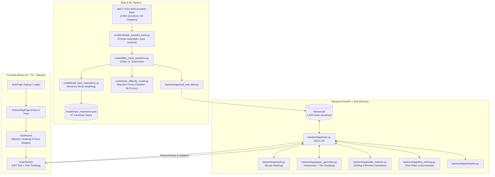

# Klassed NEET Adaptive Engine

[](https://fastapi.tiangolo.com)
[](https://react.dev)
[](https://www.typescriptlang.org)
[](https://tailwindcss.com)
[](https://scikit-learn.org)
[](https://python.org)

An intelligent, full-stack adaptive test-preparation platform engineered specifically for **NEET UG** (National Eligibility cum Entrance Test) aspirants across Physics, Chemistry, and Biology.

The engine pairs a **fixed, 13-year historical exam topic weightage** (2013–2026) with a **dynamic, per-student, per-topic difficulty state machine** and an **independent solving-pace tracking signal**, providing accurate, explainable, and personalized exam simulations.

---

## 🌟 Key Highlights

- **13-Year Unified Question Bank (2013–2026)**: Ingests 2,561+ authentic questions mapped against 25 NCERT units, 64 chapters, and 197 canonical topics.
- **Fixed Recency-Weighted Topic Importance**: Uses an exponential decay formula to lock authentic syllabus proportions that mirror real NTA NEET paper patterns.
- **Dual-Signal Student Tracking**:
  - **Mastery Level (`Basic`, `Medium`, `Advanced`)**: Driven purely by accuracy through a rolling-window state machine.
  - **Pace Flag (`Fast`, `Slow`)**: Driven by solving duration against calibrated time benchmarks (`avg_time_ratio`), filtering out noisy fast guesses.
- **Adaptive Paper Generation**: Dynamically curates 45-question tests sampled per topic according to fixed syllabus weightage and the student's current tier, with automatic supplementary drills for slow topics.
- **Machine Learning Integration**: Includes data preparation and a Random Forest Classifier trained on question metadata with **99.2% difficulty classification accuracy**.
- **Modern Computer-Based Test (CBT) Frontend**: React 18 + TypeScript + Tailwind CSS interface featuring a question palette, per-question timers, student dashboard, and post-exam review with explanations.
- **Data Quality & Validation Suite**: Automated QA scripts to reject boilerplate AI explanations, duplicate MCQ options, and non-standard metadata before ingestion.

---

## 🏗️ System Architecture



---

## 📁 Repository Structure

```
INETERNSHIP_WORK/
├── backend/
│   ├── app/
│   │   ├── __init__.py
│   │   ├── analytics.py           # Computes aggregate accuracy & subject breakdowns
│   │   ├── auth.py                # Bcrypt password hashing & student ID generation
│   │   ├── database.py            # SQLAlchemy engine, session maker & init_db
│   │   ├── db_models.py           # Student, Topic, Question, StudentTopicState, TestAttempt
│   │   ├── load_real_data.py      # Ingests & validates question bank into SQLite
│   │   ├── main.py                # FastAPI routes, CORS configuration & startup events
│   │   ├── paper_generator.py     # Samples balanced 45-question papers by topic & tier
│   │   ├── paths.py               # Absolute path anchors (DATA_DIR, MODEL_DIR)
│   │   ├── schemas.py             # Pydantic request / response models
│   │   ├── seed_test_data.py      # Development mock data generator
│   │   ├── state_machine.py       # Mastery state transition engine (rolling 3-window)
│   │   └── time_tracking.py       # Dual-signal pace calculation & benchmark checks
│   ├── tests/
│   │   └── .gitkeep               # Test directory for backend pytest suites
│   ├── klassed.db                 # Seeded SQLite database (2,394 questions, 63 topics)
│   └── requirements.txt           # Python dependencies (FastAPI, SQLAlchemy, etc.)
│
├── frontend/
│   ├── src/
│   │   ├── components/
│   │   │   ├── layout/AppShell.tsx # Sidebar navigation & signed-in user header
│   │   │   └── ui/                # Reusable Badge, Button, and Card components
│   │   ├── features/
│   │   │   ├── adaptive-paper/    # ExamScreen.tsx: CBT test runner, timer & review
│   │   │   ├── auth/              # AuthPage.tsx & OnboardingPage.tsx
│   │   │   └── dashboard/         # Dashboard.tsx: metrics, progress & topic cards
│   │   ├── lib/
│   │   │   ├── api.ts             # Typed REST API client for core endpoints
│   │   │   ├── authApi.ts         # Authentication API client
│   │   │   └── session.ts         # LocalStorage session state persistence
│   │   ├── styles/globals.css     # Tailwind styling & theme directives
│   │   ├── types/                 # TypeScript interfaces (auth.ts, index.ts)
│   │   ├── App.tsx                # Main view switcher (Auth -> Onboarding -> AppShell)
│   │   └── main.tsx               # React DOM entry point
│   ├── package.json
│   ├── tailwind.config.js
│   ├── tsconfig.json
│   └── vite.config.ts
│
├── model/
│   ├── build_attempt_training_dataset.py # Exports student attempt training sets
│   ├── build_topic_importance.py         # Computes topic weights from tagged questions
│   ├── build_training_dataset.py         # Builds feature matrix for ML models
│   ├── filter_clean_questions.py         # Segregates clean vs. quarantine questions
│   ├── importance_calculator.py          # Exponential recency decay formula
│   ├── question_difficulty_metrics.json  # Classification metrics (99.2% test accuracy)
│   ├── question_difficulty_model.joblib  # Serialized scikit-learn Random Forest model
│   ├── topic_importance.json             # Computed weights across 67 topics
│   ├── train_difficulty_model.py         # Model training pipeline
│   ├── validate_question_bank.py         # QA validator for question banks
│   └── validate_weightage_file.py        # Validates taxonomy frequency consistency
│
├── data/
│   ├── config/
│   │   └── time_benchmarks.json   # Expected solving times (Basic: 60s, Medium: 90s, Adv: 120s)
│   ├── tagged_questions/
│   │   ├── neet_questions_clean.json     # Sanitized question bank (2,394 questions)
│   │   ├── neet_all_papers_2013_2026_flawless.clean.json
│   │   └── neet_all_papers_2013_2026_flawless.quarantine.json
│   ├── taxonomy/
│   │   └── NEET_Unified_Weightage_And_Marks_2013_2026.json # 13-year chapter/unit analysis
│   └── training/
│       ├── question_features.csv  # 2,472 question feature rows
│       └── student_attempts.csv   # Historical attempt log for model training
│
└── docs/
    └── spec.md                    # Technical specification v1 (Single source of truth)
```

---

## ⚙️ Core Engine Logic

### 1. Topic Importance Engine (`model/importance_calculator.py`)
Topic weightages are fixed according to historical frequency in NEET papers, giving higher emphasis to recent years:

$$\text{importance}(t) = \sum_{y} \left[ \text{frequency}(t, y) \times 0.9^{(2026 - y)} \right]$$

Scores are normalized such that $\sum_{t} \text{importance}(t) = 100$.

### 2. Mastery State Machine (`backend/app/state_machine.py`)
Student mastery adapts after each question attempt using a rolling 3-result window:

| Current Level | Condition for Promotion | Condition for Demotion |
|:---:|:---|:---|
| **Basic** | $\ge 2$ correct out of last 3 $\rightarrow$ **Medium** | — (Floor) |
| **Medium** | 3 correct in a row (`streak >= 3`) $\rightarrow$ **Advanced** | $\ge 2$ wrong out of last 3 $\rightarrow$ **Basic** |
| **Advanced** | Stays at Advanced (retention probes) | Last 2 consecutive answers wrong $\rightarrow$ **Medium** |

*Note: Demotions use a rolling window rather than a single mistake to prevent careless errors from wiping out genuine mastery.*

### 3. Dual-Signal Pace Tracking (`backend/app/time_tracking.py`)
Pace is evaluated independently from correctness to identify students who are accurate but too slow for exam conditions:

$$\text{time\_ratio} = \frac{\text{time\_taken\_seconds}}{\text{expected\_time\_seconds}(\text{difficulty})}$$

- **Only correct answers count** toward the running average (fast guesses are ignored).
- If $\text{avg\_time\_ratio} > 1.2 \implies \text{pace\_flag} = \text{"slow"}$.
- If $\text{avg\_time\_ratio} \le 1.2 \implies \text{pace\_flag} = \text{"fast"}$.

### 4. Adaptive Paper Generator (`backend/app/paper_generator.py`)
Generates 45-question diagnostic or practice tests:
1. Calculates topic quota: $\text{quota}(t) = \text{round}\left(\frac{\text{importance}(t)}{100} \times 45\right)$.
2. Queries the question pool matching `topic_id = t` and `difficulty = student_topic_level`.
3. If the student has a `"slow"` pace flag in topic $t$, injects up to 2 additional timed practice items.

---

## 🚀 Getting Started

### Prerequisites
- **Python**: 3.10+
- **Node.js**: 18+ (with `npm`)

---

### Backend Setup

1. **Navigate to the backend directory**:
   ```bash
   cd backend
   ```

2. **Create and activate a virtual environment**:
   ```bash
   # Windows (PowerShell)
   python -m venv .venv
   .\.venv\Scripts\Activate.ps1

   # Linux / macOS
   python3 -m venv .venv
   source .venv/bin/activate
   ```

3. **Install dependencies**:
   ```bash
   pip install -r requirements.txt
   ```

4. **Verify / Load the Question Bank**:
   The repo includes an already populated `klassed.db`. If you need to re-seed or wipe clean:
   ```bash
   python -m app.load_real_data ../data/tagged_questions/neet_questions_clean.json --wipe
   ```

5. **Start the API server**:
   ```bash
   uvicorn app.main:app --reload --host 127.0.0.1 --port 8000
   ```
   Interactive Swagger docs will be live at: [http://127.0.0.1:8000/docs](http://127.0.0.1:8000/docs)

---

### Frontend Setup

1. **Navigate to the frontend directory**:
   ```bash
   cd frontend
   ```

2. **Install node dependencies**:
   ```bash
   npm install
   ```

3. **Configure Environment Variables** (Optional):
   Create a `.env` file if connecting to an external backend:
   ```env
   VITE_API_BASE_URL=http://127.0.0.1:8000
   ```

4. **Start the Vite development server**:
   ```bash
   npm run dev
   ```
   Open [http://localhost:5173](http://localhost:5173) in your browser.

---

### Model Support & Data Ingestion Pipelines

To re-run the ML training pipeline or re-calculate importance weights:

```bash
# 1. Validate question bank quality and check for issues
python model/validate_question_bank.py data/tagged_questions/neet_questions_clean.json

# 2. Re-calculate topic weightage with recency decay
python model/build_topic_importance.py data/tagged_questions/neet_questions_clean.json

# 3. Build features and train Random Forest difficulty classifier
python model/build_training_dataset.py
python model/train_difficulty_model.py
```

---

## 📡 API Reference Summary

| Method | Endpoint | Description |
|:---|:---|:---|
| `POST` | `/auth/signup` | Register a new student account (name, email, password) |
| `POST` | `/auth/login` | Authenticate an existing account |
| `POST` | `/students/{id}/onboarding` | Store academic profile (`class_level`, `target_neet_year`) |
| `GET` | `/students/{id}` | Retrieve student profile and onboarding status |
| `POST` | `/submit_attempt` | Submit an answer, record attempt, update state machine & pace |
| `GET` | `/students/{id}/state` | Get current topic mastery levels and pace flags |
| `GET` | `/students/{id}/next_paper` | Dynamically generate the next adaptive paper |
| `GET` | `/students/{id}/papers/{num}/review` | Post-exam review with answers & explanations |
| `GET` | `/students/{id}/analytics` | Overall attempts, accuracy, and subject breakdown |

---

## 🛣️ Roadmap (v2 & Beyond)

- **Bayesian Knowledge Tracing (BKT)**: Transition from discrete rule-based levels to continuous mastery probabilities ($P(L_t)$) once sufficient student attempt data is logged.
- **Adjacent Retention Probing**: Active injection of single adjacent-difficulty questions into advanced student tests to verify long-term retention.
- **Production PostgreSQL Migration**: Seamless switch from SQLite to PostgreSQL by updating `DATABASE_URL` in `database.py`.
- **Misconception Fingerprinting**: Deeper diagnostics mapping student errors against `wrong_option_tags` to surface recurring conceptual errors.

---

## 👥 Contributors

- **Udbhav Yadav** ([@udbhav968-creator](https://github.com/udbhav968-creator))
- **Pranay / Parv Wadhwa**
- Klassed Engineering Team
