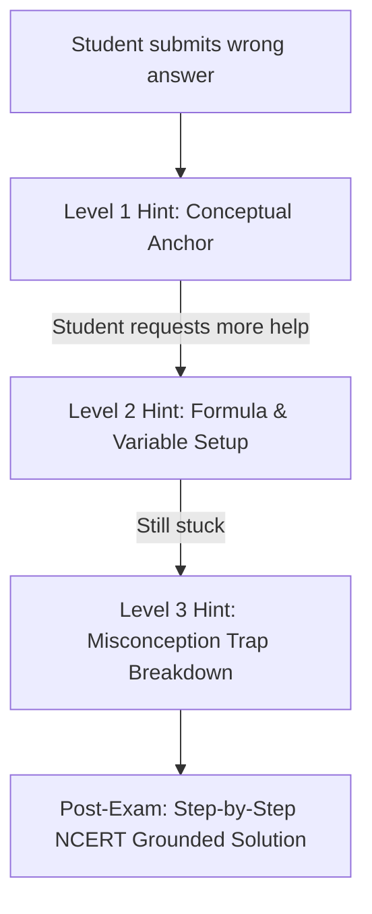

# AI/LLM Track: Automated Question Tagging QA & Socratic Explanation Proposal

> **Author**: AI/LLM Track Intern  
> **Target**: Klassed NEET Question Bank & Socratic Remediation Engine  
> **Status**: Ready for Review / RFC  
> **Scope**: Offline Batched Quality Assurance & Asynchronous Socratic Hints  
> **Constraint**: Zero coupling to the live paper generator (<50ms online latency boundary)  

---

## 1. Executive Summary & Objectives

To support the integrity of the 2,400 verified NEET PYQ question bank and guide future question scaling, the AI/LLM Track proposes an **Automated Question Tagging QA & Grounded Socratic Explanation Pipeline**.

Earlier audits revealed that synthetic questions without rigorous QA can introduce severe biases (such as 100% "a" answer keys or fabricated provenance). Furthermore, static explanations fail to help students overcome specific misconceptions.

This proposal defines:
1. **Curriculum Alignment Gate**: Automated validation of chapter, topic, and syllabus validity against the revised NTA NEET curriculum.
2. **Distractor Forensics**: Detection of ambiguous stems, multiple defensible answers, or defective distractors.
3. **Grounded Socratic Remediation**: Multi-tier adaptive hints anchored directly in NCERT textbook excerpts without hallucination or answer leaking.
4. **Architectural Decoupling**: All LLM processing runs strictly offline or via asynchronous queues, ensuring zero impact on the live test-taking engine.

---

## 2. System Architecture & Offline Decoupling

```mermaid
flowchart TD
    subgraph Core Engine (Synchronous < 50ms)
        PG["Paper Generator (Bandit + BKT)"] --> LiveExam["Exam Session"]
        LiveExam --> AttemptLog["Log Attempt (test_attempts)"]
    end

    subgraph AI/LLM Pipeline (Asynchronous & Offline)
        AttemptLog -.-> Queue["Asynchronous Job Queue (Redis / Celery)"]
        Queue --> SocraticEngine["Socratic Hint Generator"]
        
        NewQ["Incoming Candidate Question"] --> QAGate["NCERT Syllabus & Tagging QA Gate"]
        QAGate --> DistractorCheck["Distractor Quality Auditor"]
        DistractorCheck --> HallucinationGuard["NCERT RAG Grounding Check"]
        HallucinationGuard -->|Score >= 0.85| CleanBank["Verified Bank (neet_questions_clean.json)"]
        HallucinationGuard -->|Score < 0.85| ReviewQueue["Teacher Review Quarantine"]
    end
```

---

## 3. Automated Question Tagging & Syllabus Alignment Gate

### 3.1 NTA Deleted Topics Filter
The National Medical Commission (NMC) and NTA frequently update the NEET syllabus (e.g. removal of *Communication Systems*, *Earthworm*, *States of Matter* in recent years). The QA gate checks candidate questions against a canonical syllabus vector:

```python
DELETED_SYLLABUS_TOPICS = {
    "Physics": ["Communication Systems", "Transistors and Logic Gates"],
    "Chemistry": ["States of Matter", "Hydrogen", "s-Block Elements", "Polymers", "Environmental Chemistry"],
    "Biology": ["Transport in Plants", "Mineral Nutrition", "Digestion and Absorption"]
}
```

Any question tagged with a deleted topic is automatically quarantined with reason `OUTDATED_SYLLABUS`.

### 3.2 Cognitive Taxonomy Classification
Questions are categorized into four Bloom's Taxonomy cognitive depths:
- **Level 1 (Recall)**: Direct NCERT terminology, definitions, dates, and morphological characteristics.
- **Level 2 (Conceptual Application)**: Applying laws (e.g. Lenz's law, Le Chatelier's principle) to qualitative physical scenarios.
- **Level 3 (Numerical Calculation)**: Multi-step calculation with scientific notation, units, and constants.
- **Level 4 (Synthesis & Assertion-Reason)**: Evaluating two paired statements for causal validity.

---

## 4. Distractor Forensics & Option Quality Auditor

Flawed questions allow students to guess without mastery. The QA pipeline executes three forensic checks:

1. **Option Length & Token Uniformity**: Avoids the "longest option is always correct" distractor bias:
   $$\sigma(\text{Length}(O_a), \dots, \text{Length}(O_d)) \le 25\text{ tokens}$$
2. **Distractor Plausibility (Cosine Similarity)**:
   Ensures distractors are semantically related to the question context using the existing 32D SVD LSA RAG embeddings. Distractors with cosine similarity $< 0.20$ to the stem are flagged as "Nonsense Distractor".
3. **Key Position Uniformity Check**:
   Rejects question batches where any option position ($a, b, c, d$) exceeds 35% representation ($\chi^2 \text{ test at } p < 0.001$).

---

## 5. Grounded Socratic Remediation with Zero Hallucination

Rather than outputting the full answer immediately, the engine provides progressive scaffolding:



### 5.1 The Three Scaffolding Tiers

1. **Level 1 (Qualitative Concept Anchor)**:
   - Identifies the fundamental principle without numbers.
   - *Example*: *"Recall Faraday's Law and Lenz's Law: What direction must the induced current flow to oppose the change in magnetic flux?"*
2. **Level 2 (Formula & Variable Setup)**:
   - States the relevant equation and identifies the given values.
   - *Example*: *"Use $\varepsilon = -\frac{d\Phi}{dt} = -N \frac{\Delta (B \cdot A)}{\Delta t}$. Note that the magnetic field changes from 0.5 T to 0.1 T over 0.2 s."*
3. **Level 3 (Misconception Trap Warning)**:
   - Directly addresses the error that led to the student's selected option.
   - *Example*: *"Option C corresponds to forgetting the negative sign from Lenz's law. Remember that work is done against the opposing force."*

### 5.2 NCERT RAG Grounding Guarantee
Every generated explanation is cross-checked against NCERT textbook passages in `model/rag_socratic_engine.py`:
- Minimum explained cosine similarity $\ge 0.65$ against indexed NCERT text.
- If similarity $< 0.65$, generation is rejected and replaced with the verified default solution.

---

## 6. Human-in-the-Loop Dashboard & Approval Workflow

All questions generated or verified by AI are assigned an **Integrity Confidence Score** ($0.0 - 1.0$):
$$\text{Score} = 0.35 \times S_{\text{syllabus}} + 0.35 \times S_{\text{distractor}} + 0.30 \times S_{\text{rag\_grounding}}$$

- **Score $\ge 0.85$**: Automatically admitted to the clean question bank.
- **Score $< 0.85$**: Held in `data/quarantine/` for teacher review with specific flags highlighted.
- **Teacher Review Portal**: Allows faculty to edit the question stem, adjust option keys, or approve the item with a single click.
