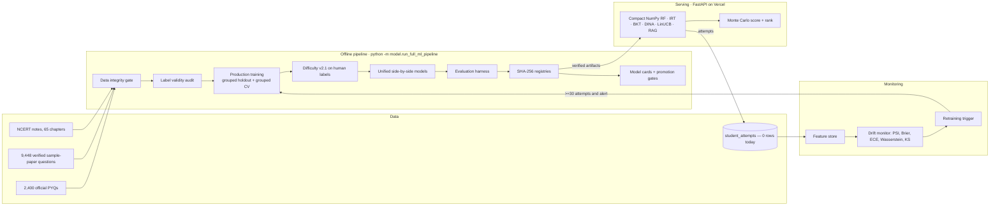

# ML System Design — Klassed NEET Adaptive Engine

Scope: the ML and MLOps side only (data, training, evaluation, registry, serving contract, monitoring, retraining). Backend and frontend internals are out of scope.

## 1. Architecture

## 2. Pipeline stages

| # | Stage | Module | Fails the run when |
|---|---|---|---|
| 1 | Data integrity gate | `data_integrity_gate.py` | Schema, answer-key or tier-coverage check fails |
| 2 | Label validity audit | `label_validity_audit.py` | Never; it records how valid the labels are |
| 3 | Production training | `training_and_validation_pipeline.py` | Holdout accuracy < 0.70, or NumPy runtime differs from sklearn |
| 4 | Difficulty v2.1 | `difficulty_model_v21_text.py` | Training error |
| 5 | Unified side-by-side | `train_on_unified_bank.py` | Training error |
| 6 | Evaluation harness | `evaluation_harness.py` | A persona invariant, latency SLA or bandit ablation fails |
| 7 | Artifact registries | `verify_artifact_integrity.py`, `ml_extension_registry.py` | Any SHA-256 mismatch |
| 8 | Model cards + promotion gates | `mlops_registry_and_cards.py` | Never; it publishes decisions |

`--verify-reproducible` re-runs everything and fails if any headline metric moves more than 0.005 from the committed value. CI installs the exact training library versions from `model/ml-training-constraints.txt`.

## 3. Evaluation protocol

| Model | Split | Leakage controls |
|---|---|---|
| Production RF | 20% grouped stratified holdout fixed **before** tuning; StratifiedGroupKFold(5) on the training 80% for tuning | Near-duplicate questions share a group; temperature fitted on training out-of-fold probabilities, checked on the holdout, and rejected if it makes the holdout worse |
| Difficulty v2.1 | GroupKFold(5) by paper | No paper in both train and test; separate score on rows without a near-duplicate in training |
| RAG retriever | Questions not in the index | Production index holds PYQs only, evaluated on all sample papers; unified index excludes held-out papers |
| LinUCB | Simulation | Cold start, noisy reward, 20 seeds, real item parameters |

## 4. Registry and promotion

| Element | Where |
|---|---|
| Core artifacts (21) with SHA-256 | `model/model_registry_manifest.json` |
| Extension artifacts (14) with SHA-256 | `model/ml_extension_registry.json` |
| Model cards with metrics, data, limitations | `model/model_cards.json`, `docs/MODEL_CARDS.md` |
| Lineage: git commit, library versions, dataset hashes | inside `model_cards.json` |
| Last pipeline run with stage timings | `model/ml_pipeline_run.json` |
| Promotion decisions | `model/promotion_gate_report.json` |

Promotion rule: a candidate is compared with the incumbent on the same held-out data. It becomes `ELIGIBLE_PENDING_HUMAN_REVIEW` only if every gate passes (difficulty: macro-F1 gain ≥ 0.02 and ECE ≤ 0.05; retrieval: top-1 gain ≥ 0.02). A reviewer then swaps the artifact, re-runs the pipeline and commits the new registry. Nothing is promoted automatically.

## 5. Serving contract

| Concern | Design |
|---|---|
| Cold start on Vercel | Forest exported to NumPy (`rf_difficulty_forest.npz`); parity with sklearn is checked on all 2,400 rows during training |
| Integrity | `/mlops/audit_overview` and `/mlops/metrics` re-verify the core SHA-256 registry on each call |
| New question (admin) | `predict_cold_start_difficulty_and_irt` returns the heuristic tier and, separately, the v2.1 tier trained on human labels |
| Score prediction | 500-trial Monte Carlo over the 3PL model; interval is an empirical quantile, not conformal |

## 6. Monitoring and retraining

| Signal | Threshold | Source |
|---|---|---|
| PSI on tier mix | > 0.20 | Conventional major-shift cutoff |
| Brier | > 1.25 × validation baseline | `validation_report.json` |
| ECE | > 1.25 × validation baseline | same |
| Minimum sample | 30 attempts, else `INSUFFICIENT_DATA` | |

When an alert fires with enough data, `continuous_retraining_engine.py` re-runs tier recalibration, training and registry verification, and records the outcome in `drift_monitor_state.json`.

## 7. What changes once students arrive

| Model | Today | After about 300 students × 180 responses |
|---|---|---|
| IRT a/b/c | Priors from tier and metadata | Fitted by marginal maximum likelihood on responses |
| BKT, DINA | Priors | EM on response sequences |
| Difficulty | Heuristic tier; v2.1 candidate | Empirical p-values and IRT b replace both |
| Score interval | Monte Carlo quantile | Split-conformal calibration on real mock-to-exam scores |
| LinUCB | Synthetic reward | Reward from observed mastery gain |
