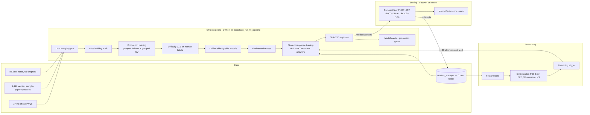
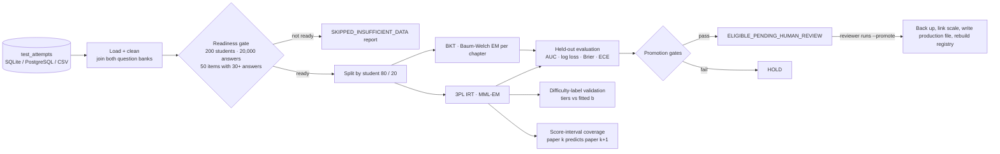

# ML System Design — Klassed NEET Adaptive Engine

Scope: the ML and MLOps side only (data, training, evaluation, registry, serving contract, monitoring, retraining). Backend and frontend internals are out of scope.

## 1. Architecture



## 2. Pipeline stages

| # | Stage | Module | Fails the run when |
|---|---|---|---|
| 1 | Data integrity gate | `data_integrity_gate.py` | Schema, answer-key or tier-coverage check fails |
| 2 | Label validity audit | `label_validity_audit.py` | Never; it records how valid the labels are |
| 3 | Production training | `training_and_validation_pipeline.py` | Holdout accuracy < 0.70, or NumPy runtime differs from sklearn |
| 4 | Difficulty v2.1 | `difficulty_model_v21_text.py` | Training error |
| 5 | Unified side-by-side | `train_on_unified_bank.py` | Training error |
| 6 | Evaluation harness | `evaluation_harness.py` | A persona invariant, latency SLA or bandit ablation fails |
| 7 | Student pipeline self-test (simulated) | `student_response_training.py` | Difficulty recovery r < 0.9, or fitted IRT not better than item p-values |
| 8 | Student-response models (real data) | `student_response_training.py` | Never; reports `SKIPPED_INSUFFICIENT_DATA` until ready, then publishes gate decisions |
| 9 | Learning-analytics self-test (simulated) | `learning_analytics_self_test.py` | Bandit OPE off by > 0.03, A/B misses a planted effect or finds a false one, anomaly detector misses a planted case |
| 10 | Learning analytics (real data) | `learning_analytics_reports.py` | Never; each section reports `INSUFFICIENT_DATA` until ready |
| 11 | Content and language audits | `exam_registry.py`, `explanation_guardrails.py`, `language_coverage.py` | Exam spec disagrees with engine constants |
| 12 | Retrieval challenger (offline) | `retrieval_backends.py` | Never; publishes HOLD / ELIGIBLE_FOR_REVIEW |
| 13 | Artifact registries | `verify_artifact_integrity.py`, `ml_extension_registry.py` | Any SHA-256 mismatch |
| 14 | Model cards + promotion gates | `mlops_registry_and_cards.py` | Never; it publishes decisions |

`--verify-reproducible` re-runs everything and fails if any headline metric moves more than 0.005 from the committed value. CI installs the exact training library versions from `model/ml-training-constraints.txt`.

## 3. Evaluation protocol

| Model | Split | Leakage controls |
|---|---|---|
| Production RF | 20% grouped stratified holdout fixed **before** tuning; StratifiedGroupKFold(5) on the training 80% for tuning | Near-duplicate questions share a group; temperature fitted on training out-of-fold probabilities, checked on the holdout, and rejected if it makes the holdout worse |
| Difficulty v2.1 | GroupKFold(5) by paper | No paper in both train and test; separate score on rows without a near-duplicate in training |
| RAG retriever | Questions not in the index | Production index holds PYQs only, evaluated on all sample papers; unified index excludes held-out papers |
| LinUCB | Simulation | Cold start, noisy reward, 20 seeds, real item parameters |

## 4. Registry and promotion

| Element | Where |
|---|---|
| Core artifacts (21) with SHA-256 | `model/model_registry_manifest.json` |
| Extension artifacts (14) with SHA-256 | `model/ml_extension_registry.json` |
| Model cards with metrics, data, limitations | `model/model_cards.json`, `docs/MODEL_CARDS.md` |
| Lineage: git commit, library versions, dataset hashes | inside `model_cards.json` |
| Last pipeline run with stage timings | `model/ml_pipeline_run.json` |
| Promotion decisions | `model/promotion_gate_report.json` |

Promotion rule: a candidate is compared with the incumbent on the same held-out data. It becomes `ELIGIBLE_PENDING_HUMAN_REVIEW` only if every gate passes (difficulty: macro-F1 gain ≥ 0.02 and ECE ≤ 0.05; retrieval: top-1 gain ≥ 0.02). A reviewer then swaps the artifact, re-runs the pipeline and commits the new registry. Nothing is promoted automatically.

## 5. Serving contract

| Concern | Design |
|---|---|
| Cold start on Vercel | Forest exported to NumPy (`rf_difficulty_forest.npz`); parity with sklearn is checked on all 2,400 rows during training |
| Integrity | `/mlops/audit_overview` and `/mlops/metrics` re-verify the core SHA-256 registry on each call |
| New question (admin) | `predict_cold_start_difficulty_and_irt` returns the heuristic tier and, separately, the v2.1 tier trained on human labels |
| Score prediction | 500-trial Monte Carlo over the 3PL model; interval is an empirical quantile, not conformal |
| Train/serve parity | One source of truth: `.python-version` (3.13) and `model/ml-training-constraints.txt`. Both requirement files pin the same versions; Docker and CI install with `-c model/ml-training-constraints.txt`; `python -m model.serving_runtime_parity --strict` fails the Docker build and CI on any library or Python mismatch (without `--strict`, as on a developer laptop with a newer Python, only library mismatches fail); the running server reports the comparison in `/mlops/health_and_drift` → `serving_runtime_parity` |
| Which RF answers | `/mlops/health_and_drift` → `rf_serving_backend`: `sklearn_joblib_pipeline`, or `compact_numpy_forest` with the load error. A fallback is logged, never silent |
| Byte-stable artifacts | `.npz` files are written by `model/deterministic_artifacts.py` (fixed zip timestamps, sorted members, rewritten only when bytes change), so a retrain on the same data leaves registry hashes unchanged |
| Secrets | `KLASSED_JWT_SECRET` comes only from the host's environment. Production refuses to start without one (≥ 32 characters); local development gets a random per-process secret |

## 6. Monitoring and retraining

| Signal | Threshold | Source |
|---|---|---|
| PSI on tier mix | > 0.20 | Conventional major-shift cutoff |
| Brier | > 1.25 × validation baseline | `validation_report.json` |
| ECE | > 1.25 × validation baseline | same |
| Minimum sample | 30 attempts, else `INSUFFICIENT_DATA` | |

When an alert fires with enough data, `continuous_retraining_engine.py` re-runs tier recalibration, training and registry verification, and records the outcome in `drift_monitor_state.json`.

## 7. Student-response training pipeline

Module: `model/student_response_training.py`. It runs inside the full pipeline as two stages: a simulation self-test that always runs, and real-data training that waits until there is enough data.



| Step | What it does | Pass condition |
|---|---|---|
| Load | Reads `data/training/student_attempts.csv`; if empty, reads `test_attempts` from `DATABASE_URL` or the local SQLite DB. Adds chapter and subject from both question banks | — |
| Readiness | Counts students, answers, and items with enough answers | 200 students, 20,000 answers, 50 items with 30+ answers |
| Split | Random 80 / 20 split **by student**, fixed seed | No student appears in both sides |
| IRT 3PL | Marginal maximum likelihood EM, 21-point quadrature, priors on a, b, c; only items with 30+ answers | — |
| BKT | Baum-Welch EM per chapter (30+ student sequences); guess and slip capped at 0.40 | — |
| Evaluation | For held-out students, the first half of their answers estimate ability; the second half is predicted. Compared: global rate, item p-value, current prior IRT, fitted IRT; prior vs fitted BKT | Metrics: AUC, log loss, Brier, ECE |
| Difficulty validation | Spearman correlation of fitted b with PYQ heuristic tiers, human-verified tiers and v2.1 tiers | Settles which difficulty labels are real |
| Score check | For students with two papers of 150+ answers, predicts the next paper's score with a 90% interval | Coverage near 90% |
| Promotion gate | Fitted vs prior on the same held-out answers | Log loss at least 1% better, AUC no more than 0.005 worse, ECE ≤ 0.05 |
| Promote | `python -m model.student_response_training --promote irt` (or `bkt`) after review. Backs up the old file, links non-fitted items onto the fitted scale (mean-sigma), writes the production file, rebuilds the registry | Refuses unless the decision is ELIGIBLE and the data label is real |

**Self-test on simulated students (always runs, clearly labelled SIMULATED):** 500 students × 120 answers from known parameters. It recovers difficulty at r = 0.98 and discrimination at r = 0.65; fitted IRT reaches AUC 0.81 vs 0.71 for item p-values. A BKT recovery check gets every parameter within 0.04 of the truth.

**Not re-fitted here:** DINA (needs a validated Q-matrix first) and LinUCB. LinUCB selection decisions and propensities are now logged (§8), so it can be evaluated offline once enough rewarded decisions with exploration exist.

**Runbook once students arrive:**

```bash
python -m model.build_attempt_training_dataset       # optional: export DB attempts to CSV
python -m model.run_full_ml_pipeline                 # trains, evaluates, publishes decisions
cat model/student_models/student_response_training_report.json
python -m model.student_response_training --promote irt   # only after review
python -m model.run_full_ml_pipeline --verify-reproducible
python -m model.tests.test_ml_standalone_suite
```

## 8. Learning analytics, experiments and scale

```mermaid
flowchart LR
  A[next_paper] -->|arm = hash(student)| B{A/B arm}
  B -->|adaptive| C[LinUCB scores, greedy or epsilon-greedy]
  B -->|random_control| D[Uniform random within the same pools]
  C --> E[(selection_decisions: candidates, scores, propensity, arm)]
  D --> E
  F[submit_attempt] -->|bandit reward| E
  G[v2_insights] --> H[(score_prediction_snapshots, one per student per day)]
  E --> I[learning_analytics_reports]
  H --> I
  J[test_attempts] --> I
  K[neet_actual_scores.csv / student_attributes.csv] --> I
  I --> L[OPE, A/B, score validation, fairness, solve times, anomalies, BKT vs PFA]
```

| Part | Module | Design |
|---|---|---|
| Decision logging | `decision_logging.py`, `backend/app/paper_generator.py` | Every served question records its candidate set (top 60), scores, the policy, the arm and the exact probability it had of being chosen. The bandit reward is attached when the answer arrives |
| Exploration | env `KLASSED_BANDIT_EXPLORATION_EPSILON` (default 0, max 0.5) | Epsilon-greedy with exact propensities; at 0 the policy is unchanged (greedy) |
| A/B test | `experiments.py`, env `KLASSED_EXPERIMENT_SELECTION_AB` (default off) | SHA-256 hash of student id → 50/50 adaptive vs random control; sample-ratio-mismatch check (chi-square, p < 0.001); outcome = accuracy change first→last paper; bootstrap 95% CI; minimum detectable effect |
| Off-policy evaluation | `offline_policy_evaluation.py` | IPS and self-normalised IPS with weight clipping and effective sample size; needs logged propensities below 1 |
| Score validation | `score_validation.py` | Latest snapshot at least 7 days before the exam vs the real score: MAE, RMSE, bias, coverage of the 90% range, calibration by decile |
| Fairness | `fairness_report.py` | Per group: BKT next-answer AUC / log loss / ECE and score-range coverage; flags AUC gap > 0.05, ECE > 0.05, coverage gap > 10 points; groups under 50 students are not evaluated |
| Real solve times | `empirical_item_times.py` | Median log-time per question shrunk toward the formula value with weight n/(n+20) |
| Anomalies | `anomaly_detection.py` | lz* person-fit on 3PL, rapid-guess share, answer-copy index (binomial on identical wrong options). Human review only |
| KT challenger | `kt_challenger.py` | PFA vs BKT on held-out students; deep KT (SAKT/AKT) deliberately deferred until about 1M answers |
| Shared state | `state_store.py` | With `REDIS_URL`, bandit state and features are per-student Redis keys (TTL 180 / 30 days) shared by all servers; without it, behaviour is unchanged |
| Releases | `release_registry.py`, `model/releases.json` | candidate → staging (canary %) → production (named reviewer) → archived; `rollback` restores the previous production set from git |
| Weekly retraining | `.github/workflows/scheduled_retraining.yml` | Runs only when `KLASSED_ANALYTICS_DATABASE_URL` (read-only replica) is set; uploads reports and a candidate release; never promotes |
| Exams | `exam_registry.py` | NEET-UG spec checked against engine constants every run; other exams follow the onboarding checklist |
| Retrieval | `retrieval_backends.py` | Any encoder is compared with production on the same 9,448 held-out questions; gate top-1 gain ≥ 0.02 |
| Explanations | `explanation_guardrails.py` | Grounded prompt + checks (answer key, boilerplate, numbers, grounding) for stored and AI-written explanations |
| Languages | `language_coverage.py`, `data/translations/<lang>/questions.jsonl` | 12 Indian languages; numbers, formulas and script checked; approval needs a second person |
| Privacy | `privacy_settings.py`, env `KLASSED_BEHAVIOURAL_TELEMETRY` | `off` stores no answer switches or hesitation |

Runbook: see `docs/ML_OPERATIONS_RUNBOOK.md`.
